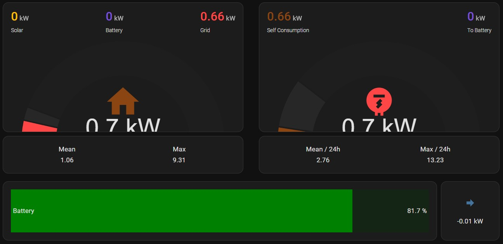

# Energy flow gauge displaying energy consumption and generation.

This is a set of gauges displaying energy flow from grid, solar and battery.



# Pre-requirements

This has not been tested on HA earlier than 2024.9 and requires the following HACS addons:

- [Apex-Charts card](https://github.com/RomRider/apexcharts-card)
- [Config Template Card](https://github.com/custom-cards/config-template-card)
- [lovelace-card-mod](https://github.com/thomasloven/lovelace-card-mod)
- [Button Card](https://github.com/custom-cards/button-card)

The sensor names needs to be changed to suit your system.

# Installation
1. Copy `power_flow_gauges_sigen.yaml` into `config/packages/`. Enable packages
   by merging the following into `configuration.yaml` (keep any existing
   `homeassistant` settings):

   ```yaml
   homeassistant:
     packages: !include_dir_named packages
   ```

2. Replace the source entity IDs with your actual IDs. The examples expect kW
   power readings and the built-in **Battery time remaining** sensor in hours.
   Battery power is positive when charging and negative when discharging.
3. Check the Home Assistant configuration, then restart to load the package.
4. Open an empty, manually managed dashboard's **Raw configuration editor** and
   paste `energy_flow.yaml`. This file starts with `views:` and defines a whole
   dashboard; it cannot be pasted into a single card's YAML editor.

In B4, missing source readings make dependent gauge sensors unavailable instead
of reporting fabricated zeroes. Statistics may need some valid samples after
startup. The existing battery-minutes helper converts the integration's estimate
from hours to minutes. If you previously copied this package, update your copy
manually and preserve any local entity-ID mappings; integration updates do not
replace your dashboard configuration.

For Home Assistant's built-in Energy Dashboard, see the
[sensor mapping guide](../../docs/USAGE.md#home-assistant-energy-dashboard).

# Configuration 

In the chart-card you should change the following variables to suit your needs:

  - Check so the sensor names are correct.
